# Komodo compiler internals

A contributor guide to the self-hosted compiler: how a source file becomes
target text, where each stage lives, how the bootstrap works, and how to
add a feature or a target. For the language itself see
[the language reference](language/reference.md); for installing and using the CLI see
[`README.md`](../README.md).

## Contents

- [1. The pipeline](#1-the-pipeline)
- [2. Directory and module map](#2-directory-and-module-map)
- [3. Module merging](#3-module-merging)
- [4. Front end: lexer, parser, AST](#4-front-end-lexer-parser-ast)
- [5. Analyzer: types and annotations](#5-analyzer-types-and-annotations)
- [6. Optimizer](#6-optimizer)
- [7. Codegen and the Backend interface](#7-codegen-and-the-backend-interface)
- [8. Adding a target](#8-adding-a-target)
- [9. Runtime ABI](#9-runtime-abi)
- [10. Self-hosting, the seed and the fixpoint](#10-self-hosting-the-seed-and-the-fixpoint)
- [11. Adding a language feature](#11-adding-a-language-feature)
- [12. Tests](#12-tests)
- [13. Known design debts](#13-known-design-debts)
- [14. Stale documentation](#14-stale-documentation)

## 1. The pipeline

```mermaid
flowchart LR
    src["source files<br/>.km / .kmm"] --> gather["gather<br/>main.km"]
    gather -->|"merged text + file map"| lex["Lexer<br/>frontend/lexer.kmm"]
    lex -->|tokens| parse["Parser<br/>frontend/parser.kmm, parser_expr.kmm"]
    parse -->|Program AST| sema["Analyzer<br/>analyze/sema*.kmm, types.kmm"]
    sema -->|"resolvedType, resolvedSym, site"| opt["Optimizer<br/>optimize/optimize.kmm"]
    opt --> cg["Codegen<br/>codegen/codegen*.kmm, overload.kmm"]
    cg -->|"Backend operations"| be["Backend<br/>backend/backend*.kmm"]
    be --> text["target text<br/>x86 asm, stack-VM, C"]
```



The same flow in text. The entry point is `compileMapped` in
[`modules/km_compiler.kmm`](../modules/km_compiler.kmm):

```text
Lexer.tokenize()            -> [Token]
Parser.parseProgram()       -> Program (AST)
Analyzer.analyze(ast)       -> annotates the AST, throws on the first error
Optimizer.run(ast)          -> no-op at --opt none
Codegen(selectBackend(t)).compileProgram(ast) -> target text
```

Errors are thrown as `"line:col: message"` strings. `main.km` maps them back to
`file:line:col: error: ...` against the file the line came from (see
[section 3](#3-module-merging)).

## 2. Directory and module map

Line counts are from `wc -l` on this checkout. Every `.kmm` file is
`module km_compiler`, so the whole compiler is one module spread over folders.

| File | Lines | Role |
|---|---:|---|
| [`main.km`](../main.km) | 383 | Driver: argument parsing, module gathering, error mapping, `main` |
| [`modules/km_compiler.kmm`](../modules/km_compiler.kmm) | 135 | `compileMapped` pipeline entry, `selectBackend`, `save` |
| [`modules/frontend/lexer.kmm`](../modules/frontend/lexer.kmm) | 655 | Source text to `Token`s (`Lexer`, `TokenType`) |
| [`modules/frontend/parser.kmm`](../modules/frontend/parser.kmm) | 880 | Recursive-descent declarations and statements (`Parser`) |
| [`modules/frontend/parser_expr.kmm`](../modules/frontend/parser_expr.kmm) | 270 | Expression precedence climb |
| [`modules/frontend/ast.kmm`](../modules/frontend/ast.kmm) | 366 | AST node structs, including the annotation fields |
| [`modules/analyze/types.kmm`](../modules/analyze/types.kmm) | 214 | `Type` lattice; `parseTypeStr`, `typeToLegacy` |
| [`modules/analyze/sema.kmm`](../modules/analyze/sema.kmm) | 1078 | `Analyzer` class: state, driver passes, registries, diagnostics |
| [`modules/analyze/sema_expr.kmm`](../modules/analyze/sema_expr.kmm) | 713 | `inferExpr` / `inferRaw` / `inferCall`: type inference |
| [`modules/analyze/sema_stmt.kmm`](../modules/analyze/sema_stmt.kmm) | 810 | `checkFunction` / `checkStmt`, flow narrowing, `checkParamDefaults` |
| [`modules/optimize/optimize.kmm`](../modules/optimize/optimize.kmm) | 738 | `Optimizer`: folding, identities, DCE, four levels |
| [`modules/codegen/codegen.kmm`](../modules/codegen/codegen.kmm) | 1140 | `Codegen` class: state, `compileProgram`, function-signature registry |
| [`modules/codegen/codegen_frame.kmm`](../modules/codegen/codegen_frame.kmm) | 186 | Frame slots, `typeOf`, `exprType` fallback inference |
| [`modules/codegen/codegen_stmt.kmm`](../modules/codegen/codegen_stmt.kmm) | 553 | Statement lowering (`genStmt`, `genMatch`, loops) |
| [`modules/codegen/codegen_expr.kmm`](../modules/codegen/codegen_expr.kmm) | 906 | Expression lowering (`genExpr`, `genCall`, `genNew`) |
| [`modules/codegen/overload.kmm`](../modules/codegen/overload.kmm) | 411 | Overload selection and generic monomorphisation |
| [`modules/backend/backend.kmm`](../modules/backend/backend.kmm) | 125 | `abstract class Backend`: operation vocabulary and shared bookkeeping |
| [`modules/backend/backend_x86.kmm`](../modules/backend/backend_x86.kmm) | 1401 | `X86Backend`: System V AMD64, NASM (reference lowering) |
| [`modules/backend/backend_stackvm.kmm`](../modules/backend/backend_stackvm.kmm) | 493 | `StackVMBackend`: textual stack-VM bytecode |
| [`modules/backend/backend_c.kmm`](../modules/backend/backend_c.kmm) | 639 | `CBackend`: portable C, also used for `wasm` |
| [`modules/support/strindex.kmm`](../modules/support/strindex.kmm) | 60 | `StrIndex`: string-to-position hash index |
| [`stdlib/km_runtime.h`](../stdlib/km_runtime.h) | 248 | Runtime ABI: word layout, `KmArray`, `KmArg`, prototypes |
| [`stdlib/runtime.c`](../stdlib/runtime.c) | 695 | Entry point, allocation on the collected heap |
| [`stdlib/km_error.c`](../stdlib/km_error.c) | 577 | Crash handlers, Komodo stack traces, error propagation |
| [`stdlib/string.c`](../stdlib/string.c) / [`file.c`](../stdlib/file.c) / [`math.c`](../stdlib/math.c) / [`algorithm.c`](../stdlib/algorithm.c) / [`console.c`](../stdlib/console.c) | 268 / 193 / 131 / 160 / 47 | Standard library implementations |
| `stdlib/*.kmm` | 9 to 822 | Declarations for the libraries (ordinary modules; `raylib.kmm` is largest) |
| [`build-self.sh`](../build-self.sh) | 159 | Bootstrap and fixpoint check for `./kmc` |
| [`run-tests.sh`](../run-tests.sh) | 105 | Example suite across x86, stackvm, c and wasm |
| [`run-sema-tests.sh`](../run-sema-tests.sh) | 89 | Analyzer diagnostic tests |
| [`komodo`](../komodo) | ~1100 | User CLI: front end via `kmc`, then `nasm` / `gcc` / `emcc` |
| [`bootstrap/main.km.asm.gz`](../bootstrap/main.km.asm.gz) | binary | Checked-in seed: assembly of the compiler |

Subfolders group the stages: `frontend/`, `analyze/`, `optimize/`,
`codegen/`, `backend/`, `support/`.

## 3. Module merging

The compiler does not link modules separately. `main.km` concatenates every
source it reaches into one translation unit, then compiles that once. The
logic is `gather` in [`main.km`](../main.km):

1. Start a queue with the file named on the command line.
2. Pop a file, read it, record its first line number in `starts`, and append
   its text to `parts`.
3. Each `import X` line is resolved with `file::find(X, rootPath)`, then
   falls back to `file::find(X, stdlibProbe)`. The probe is inside the
   compiler's own directory, so the standard library resolves from anywhere.
4. If the file has a `module M` line, every other `.km` / `.kmm` file in the
   whole subtree of its directory (`sourceTree`) that declares `module M` is
   queued too. This is why `modules/` can be grouped into folders.
5. `link` lines and block `extern "lib"` headers become linker tokens
   (`-lname`, or a path resolved against the declaring module's directory).

The output is `source` (all parts joined by `"\n"`), `deps` (the exact file
list), `links`, and `starts`. `main.km` writes `<file>.deps` and
`<file>.links` next to the input. `starts` lets `locate` in `km_compiler.kmm`
rewrite a merged-unit line `L` into `file:line` for diagnostics, and it
handles errors from imported files too.

Because the parser tolerates repeated `module` and `import` lines, the merged
text needs no per-file namespace handling. The analyzer's duplicate-definition
check (`duplicate function`) applies to the merged program.

## 4. Front end: lexer, parser, AST

- **Lexer** (`class Lexer`, `tokenize()`): produces `[Token]`. A string
  interpolation (`` `n = {n + 1}` ``) is lexed into sub-tokens by a nested
  `sub.tokenize()`. Numeric literals (digit separators, `0x`, `0b`) are lexed here.
- **Parser** (`class Parser`, `parseProgram()`): recursive descent for
  declarations and statements. `parseParams` (around line 202) reads
  `name: T = default` and stores the expression in `Param.defaultValue`.
  Expression parsing is in `parser_expr.kmm`, one function per precedence
  level (`parseOr` → `parseAnd` → … → `parseUnary` → `parsePrimary`).
- **AST** ([`ast.kmm`](../modules/frontend/ast.kmm)): `struct` nodes with
  `abstract struct` bases `Expression`, `Statement`, `Declaration`. Declared
  types are kept as strings (`"int"`, `"string?"`, `"[Token]"`). Nothing in
  the AST records a semantic type except the annotation fields described in
  section 5.

The parser does not resolve names. It builds call nodes (`CallExpr`, `MethodCallExpr`)
from the syntax, and the analyzer decides which function or method each one names
(`CallExpr.resolvedSym`).

## 5. Analyzer: types and annotations

`Analyzer.analyze(prog)` in [`sema.kmm`](../modules/analyze/sema.kmm) runs
these passes in order:

| Pass | What it does |
|---|---|
| 0 | Register enums, then structs and classes parent-first (`orderTypes`) |
| 1 | Register free-function and method signatures. Generic templates and overload sets are exempted from the single-definition rule |
| 1b | `checkParamDefaults` on every function |
| 2 / 2b | Top-level macros (`let NAME be EXPR`) and top-level variables |
| 3 | `checkFunction` on every non-template body, then the lint warnings |

The type lattice is in [`types.kmm`](../modules/analyze/types.kmm): `Type`
with `kind` (`int`, `float`, `array`, `nullable`, `object`, `fn`, …). Analysis
runs on `Type`. Codegen only sees strings.

Annotations the analyzer writes into the AST:

- `Expression.resolvedType` (`string?`, [`ast.kmm`](../modules/frontend/ast.kmm)
  line 28): set by `inferExpr` to `typeToLegacy(t)`, a coarse string such as
  `"int"`, `"float"`, `"string"`, `"[T]"`, or an object name. It is left null
  when the type is `any`, so codegen falls back to its own inference.
- `CallExpr.resolvedSym`: the link symbol the call resolves to.
- `CallExpr.site`: for the built-in `assert`, the `file:line: ` prefix.
- `Program.analyzed` and `Program.usesCopy`.

Flow narrowing (`x == null`, `x is T`, diverging branches) happens in
`sema_stmt.kmm`: `checkStmt` threads the narrowed scope through `if` arms, and
`inferExpr` reads that scope through `m_scopeType`. The mutation contract
(`fn` / `mut` / `void`) is `checkMutationContract`.

Codegen does not re-analyze, but it does re-infer. Where `resolvedType` is
null, `exprType` in [`codegen_frame.kmm`](../modules/codegen/codegen_frame.kmm)
(line 63) classifies the expression from literal kinds, locals, fields,
macros, and call return types. It also re-derives some shapes (struct
pattern binding types, `overloadRet`, `inferReturnType`) that the analyzer
could have recorded. See [section 13](#13-known-design-debts).

## 6. Optimizer

[`optimize.kmm`](../modules/optimize/optimize.kmm) is an AST rewrite between
the analyzer and codegen. `Optimizer.run` returns immediately when the level
is `none`.

| Level | Adds |
|---|---|
| `none` | nothing; the backend keeps every literal |
| `low` | constant folding for int, string and bool (`foldIntInt`, `foldStrStr`, `foldLogical`) |
| `medium` | algebraic identities, strength reduction (`x * 2^k` to `x << k`), dead-branch elimination, dead code after a diverging statement |
| `max` | constant propagation of never-reassigned `let x = <literal>` bindings, then another fold |

Rewrites must keep observable behaviour. Folding is skipped for division by
zero, results outside `FOLD_LIMIT`, and string literals with escapes.
Replacement literals are re-stamped with `resolvedType` so codegen's fast
path still applies.

## 7. Codegen and the Backend interface

`Codegen` walks the AST once and never names an instruction. It drives an
operand stack through a `Backend`:

```text
evaluate left          -> one value on the backend's stack
m_backend.pushAcc()    -> spill boundary
evaluate right         -> second value
m_backend.binaryInt("+")  -> pops two, pushes the sum
```

The class layout is:

- `codegen.kmm`: `class Codegen` and its constructor `constructor(backend: Backend)`.
  `compileProgram` runs the passes (macros, globals, enum constants, function
  registry), then `genFunction` for each function, then the instantiation
  queue for generic templates.
- `codegen_frame.kmm`: each local gets an 8-byte slot. `slotOf` returns the
  byte offset (8, 16, 24, …), which a backend interprets for its target.
- `codegen_stmt.kmm` and `codegen_expr.kmm`: the walk itself, with calls to
  `m_backend.*`.
- `overload.kmm`: `selectOverload` picks an overload from static argument
  types, or asks for a runtime type-id dispatch. `ensureInstance` clones a
  template for a call site's argument types and queues it.

The `Backend` vocabulary is documented in the header of
[`backend.kmm`](../modules/backend/backend.kmm), grouped as: lifecycle
(`begin`, `beginFunction`, `endFunction`, `finish`), constants, locals and
globals, the stack (`pushAcc`, `pushAccFloat`), integer and float ops, strings,
arrays (`arrayBegin`, `arrayStoreElem`, `arrayEnd`, `indexAcc`, `indexAssign`),
objects (`objNew`, `loadField`, `storeField`), errors (`throwErr`, `tryBegin`,
`tryEnd`), control flow, loops (`forInInit`, `forInHead`), calls
(`callFrameBegin`, `callArgStore`, `callFrameEnd`) and the C FFI
(`cCallBegin`, `cCallArg`, `cCallEnd`).

`abstract class Backend` itself declares only a few hooks with defaults:
`inPlaceAppend`, `arrayPushTo`, `arrayPushToField`, `newLabel`, `declareFn`,
`isLocalFn` and `mangle`. The rest of the vocabulary is by convention: every
concrete backend implements the names listed in the header. Section 13 notes
the consequence.

Frame offsets are handed out by `Codegen`. A register target reads them as
`[rbp - off]`. The x86 backend reserves offset 8 for the saved `rbx`, so the
first real local is at `[rbp - 16]`.

## 8. Adding a target

A target is a `<T>Backend : Backend` class plus one registration. Nothing in
the lexer, parser, analyzer, optimizer or codegen walk changes.

The C target is the most recent example. These are the places it touched,
from commits `83e672c` and `de7bfb3`:

1. **The class**: [`backend_c.kmm`](../modules/backend/backend_c.kmm),
   `class CBackend : Backend` (line 44). It implements the operation
   vocabulary as C text, with `pushAcc` declaring a temporary and
   `binaryInt` naming it. The C prelude (`preludeLines`) defines
   `KM_CALL`, a `_Generic` shim for stdlib calls (line 193).
2. **Registration**: [`km_compiler.kmm`](../modules/km_compiler.kmm),
   `selectBackend`. This is the only place the set of targets is known. A
   `"wasm"` case reuses `CBackend` with `forWasm()`.
3. **Driver target list**: [`main.km`](../main.km) accepts the target name in
   its trailing-argument loop (around line 34), and the error text in
   `selectBackend` lists the known targets.
4. **Front-end script**: [`komodo`](../komodo) validates `-t` (around line 153)
   and decides how to produce and run output per target. The check at line
   351 limits which targets are assembled and run.
5. **Test leg**: [`run-tests.sh`](../run-tests.sh) gets a `c` (and `wasm`)
   block that builds and runs each example and diffs it against
   `.expected`. An example that cannot run on the target opts out with a
   marker comment (`c: skip`, `wasm: skip`). The C commit added `c: skip` to
   `tests/examples/ffi_callback.km` and `tests/examples/ffi_struct.km` for this reason.

A new target that cannot express an operation fails with a message like
`c backend: ... not supported yet`. Passing a Komodo function to C as a
callback and `extern fn` with by-value structs were such cases.

`StackVMBackend` is the smallest example: its header states that operands
simply stay on the stack, so the spill and call-buffer operations emit nothing.

## 9. Runtime ABI

The contract between generated code and [`stdlib/`](../stdlib) is in
[`km_runtime.h`](../stdlib/km_runtime.h).

**Words.** A Komodo value is one 64-bit word (`int64_t`):

| Type | Word |
|---|---|
| `int` | the integer |
| `float` | the IEEE-754 bit pattern (in `xmm0` on x86) |
| `bool` | 0 or 1 |
| `string` | pointer to a NUL-terminated `char` buffer |
| array | pointer to `KmArray` |
| object / class / struct | pointer to `[ type id | field 0 | field 1 | … ]` |

Pointers are stored zero-extended (`KM_WORD` / `KM_PTR`), which is the
identity on x86-64 and keeps the C backend correct on wasm32.

**Arrays.** `KmArray` is `{ int64_t len; int64_t cap; int64_t data[]; }`. The
handle points at the header, so `data(arr)` is `handle + 16`. An array's
element description is packed into its tag word: `KM_TAG_ARRAY + (leaf << 8)
+ (depth << 16)`.

**Objects.** The header word holds the integer runtime type id, which
`is` checks and virtual dispatch use. Fields start at `handle + 8`.

**Call ABI.** Every Komodo function, user or stdlib, has the same native shape:

```c
int64_t f(int64_t argc, KmArg *items);   /* rdi = argc, rsi = items */
/* KmArg { int64_t tag; int64_t value; }   tag: KM_TAG_INT / FLOAT / STR / BOOL / ARRAY */
```

The compiler fills the `KmArg` records (`callFrameBegin` / `callArgTag` /
`callArgStore`). The callee reads them by index. The return value comes back
in `rax`, or `xmm0` for a float. Stdlib functions that return a float are
declared `double` in the header.

**Memory.** Every heap value is allocated with `km_alloc` (zeroed, may hold
pointers), `km_alloc_atomic` (pointer-free bytes) or `km_strndup` on the
Boehm collector. Never use libc `malloc` for values the program can see.

**C FFI.** `extern fn` calls use the System V AMD64 convention directly
(`cCallBegin` / `cCallArg` / `cCallEnd` on the x86 backend). Only structs of
16 bytes or less with scalar fields are supported by value; see the
`CLayout` struct in [`codegen.kmm`](../modules/codegen/codegen.kmm).

## 10. Self-hosting, the seed and the fixpoint

The compiler compiles its own sources. [`build-self.sh`](../build-self.sh)
produces `./kmc` in these stages:

```text
main.km + modules/**/*.kmm
   --bootstrap-->  main.km.asm           (any compiler that already exists)
   --nasm + gcc--> ./kmc                 (with stdlib/*.c, cached in .build/obj)
   --./kmc main.km x86--> main.km.asm    (stage 2)
   compare with the bootstrap output     (fixpoint: byte-identical)
```

The bootstrap compiler is chosen in this order:

1. `$KMC`, a prebuilt binary.
2. `./kmc`, if it already exists.
3. The **seed**, [`bootstrap/main.km.asm.gz`](../bootstrap/main.km.asm.gz).
   It is gunzipped, assembled and linked, then run on `main.km`. This needs
   only `nasm` and `gcc`.
4. The Python reference interpreter (`$KOMODO_MAIN`). It is slow, about two
   minutes, and runs under PyPy when available.

Other behaviour:

- **Incremental.** A hash of `build-self.sh`, `main.km`, `stdlib/*.c|h` and all
  `modules/**/*.kmm` is stored in `.build/stamp`. If it matches and `./kmc`
  exists, the script exits. `--force` ignores the stamp.
- **Fixpoint.** After linking, the script recompiles `main.km` with the new
  `kmc` and compares. If they differ, it goes one stage further. A build is
  accepted when two consecutive stages agree. Otherwise it fails.
- `--fast` skips the fixpoint check. `--update-seed` rewrites the seed after a
  successful build.

**`komodo self seed`** runs `./build-self.sh --force --update-seed`. Commit the
refreshed `bootstrap/main.km.asm.gz` with the source change that caused it.

**When to refresh the seed.** The seed is the compiler as it was when the
seed was made. It can only compile sources written in the syntax it knows.
Refresh it whenever you change how the compiler is compiled, for example a
new language feature that the compiler's own sources will use, or a codegen
change. Refreshing it is what lets a fresh clone build with only `nasm` and
`gcc`.

**Rule: never use new syntax in the compiler sources until the seed supports
it.** Build order matters here. If `modules/` uses a feature that the seed
does not know, a clone without `./kmc` fails at the bootstrap stage. Land the
compiler change, run `komodo self seed`, commit the seed, and only then write the
feature into `modules/`. A developer with an existing `./kmc` will not see
this, which is why it is easy to miss.

## 11. Adding a language feature

Checklist. Not every step applies to every feature.

1. **Lexer** (`lexer.kmm`): add a `TokenType` only when the feature needs a
   new token. Keywords and operators are the usual cases.
2. **AST** (`ast.kmm`): add a node, or a field on an existing node. Annotation
   fields that codegen needs go here too, with a comment saying which stage
   writes them.
3. **Parser** (`parser.kmm`, `parser_expr.kmm`): add the grammar, and reject
   misplaced forms with a parse error.
4. **Analyzer** (`analyze/`): check the rule and set annotations. `sema.kmm`
   for declarations and passes, `sema_expr.kmm` for expressions,
   `sema_stmt.kmm` for statements.
5. **Optimizer** (optional): fold or rewrite the node at `medium` or `max` only
   if it is worth it.
6. **Codegen** (`codegen/`): lower the node through existing `Backend`
   operations. Prefer lowering to existing AST nodes, as `assert` does (below),
   over adding a backend operation.
7. **Backends** (only if a new operation is unavoidable): add it to every
   backend, `backend.kmm`'s header vocabulary, and the `CBackend` and
   `StackVMBackend` implementations.
8. **Tests**: an `tests/examples/<name>.km` with `.expected`, and `tests/sema/`
   negatives with `.experr`. See [section 12](#12-tests).
9. **Docs**: a section in `docs/language/reference.md`, a bullet in `README.md`'s Status.
10. **Seed**: if `modules/` will use the feature, refresh the seed first
    ([section 10](#10-self-hosting-the-seed-and-the-fixpoint)).

### Worked example: default parameter values

Commit `17c1bae` (`default parameter values for free functions`)
touched 26 files. It is a good model because it spans every stage.

- **Parser**: `Parser.parseParams` (around line 202 of
  [`parser.kmm`](../modules/frontend/parser.kmm)) reads `= expr` after a type
  and stores it in `Param.defaultValue` ([`ast.kmm`](../modules/frontend/ast.kmm),
  line 251).
- **Analyzer**: `checkParamDefaults` in
  [`sema_stmt.kmm`](../modules/analyze/sema_stmt.kmm) (line 124) enforces the
  rules: a literal default only, trailing parameters only, free functions
  with a body only (no methods, externs, prototypes, constructors or
  variadics), no overloaded names, and assignability to the declared type.
  `sema.kmm` calls it in pass 1b. Call-site arity becomes a range in
  `sema_expr.kmm`, which gives the message `'greet' takes 1 to 2 argument(s)`.
- **Codegen**: `Codegen::fillDefaults` (line 390 of
  [`codegen_expr.kmm`](../modules/codegen/codegen_expr.kmm)) appends the
  callee's default expressions to a short argument list. It is called from
  `genCall` (lines 522 and 547) and from `exprType` for templates
  ([`codegen_frame.kmm`](../modules/codegen/codegen_frame.kmm), line 126).
- **Tests**: `tests/examples/default_params.km` with `.expected`, and seven
  `tests/sema/default_*.km` files covering arity, method, non-literal, order,
  overload, template arity and type errors.

### Worked example: built-in `assert`

Commit `5dcb048` (`built-in assert(cond, "message")`) is a
smaller example, and it is useful because it needed no backend operation.

- **AST**: `CallExpr.site` (`ast.kmm`, line 83) holds the `file:line: ` prefix.
- **Analyzer**: `Analyzer::inferCall` (`sema_expr.kmm`, line 268) checks the
  arity (1 or 2), requires the message to be a string, and fills `e.site`
  with `locate(...)`. Only the analyzer has the file map, so the file name is
  resolved here.
- **Codegen**: `Codegen::genCall` (`codegen_expr.kmm`, line 399) rewrites
  `assert(c, m)` into `if not c then throw "<site>assertion failed: m"`,
  builds the nodes, and calls the existing `genStmt`. The message is only
  evaluated on failure.
- **Tests**: `tests/examples/assert_demo.km` and `tests/sema/assert_arity.km`,
  `tests/sema/assert_message_type.km`.

The lesson: a feature that can be written as existing AST nodes needs no
backend work, and so it works on every target at once.

## 12. Tests

Two suites, both driven by the native compiler. Build `./kmc` first with
`./build-self.sh` (or `komodo self build`; plain `komodo` also builds it on demand).

**Examples: `./run-tests.sh [name ...]`.** Each `tests/examples/<name>.km` is run
through the `komodo` script, so the front end, `nasm`, and `gcc` are all
exercised. The output must match `tests/examples/<name>.expected` exactly (the
script diffs it). Each example is then also:

- compiled with `-t stackvm -S`, unless the source contains `stackvm: skip`
- built and run with `-t c`, unless it contains `c: skip`
- built and run with `-t wasm`, if `emcc` and `node` are installed, unless it
  contains `wasm: skip`

Markers are plain comments in the `.km` file. Use them only when the
example needs the native C ABI (FFI, SDL, raylib).

**Analyzer diagnostics: `./run-sema-tests.sh [filter ...]`.**

- `tests/sema/<name>.km` is compiled in default mode. It must fail, and its
  stderr must contain the text of `tests/sema/<name>.experr` as a substring.
- `tests/sema/strict/<name>.km` must fail with `--strict` and its `.experr`
  text, and it must compile cleanly in default mode. That second check proves
  the lint is strict-only.

The `.km.deps` and `.km.links` files next to each sema test are written by
`gather` when the test is compiled, and they are tracked in git.

## 13. Known design debts

These are real and verified against the source. None blocks work, but each
will cost you time when you touch the area.

1. **Duplicated helpers between Analyzer and Codegen.** The same names are
   defined in both halves with separate implementations. Examples: `typeIndex`
   (`sema.kmm` line 325, `codegen.kmm` line 810), `isObjType` (`sema.kmm:328`,
   `codegen.kmm:669`), `isAbstractType`, `typeParentOf`, `isDescendantOf`,
   `pushMacro`, `isMacro`, `isGlobalVar`, `hasFn`, `methodSym`, `parentOrEmpty`,
   `receiverType` and `dotIndex`. Digit helpers also exist in more than one place
   (`digitVal` in `km_compiler.kmm`, `digit` and `hexDigit` in `optimize.kmm`).
   The fix is a shared module, or the analyzer's answers recorded on the AST
   so codegen does not need its own copy.
2. **Codegen's `exprType` fallback inference.** `exprType`
   ([`codegen_frame.kmm`](../modules/codegen/codegen_frame.kmm), line 63)
   returns `resolvedType` when set and otherwise classifies the expression
   itself. The analyzer leaves `resolvedType` null for `any`, so the fallback
   is the path used for the less common shapes. Some of the codegen-side
   inference (`inferReturnType`, `overloadRet`, `structPatBindType`) repeats
   work the analyzer already did.
3. **Long functions: `genCall` and `inferCall`.** `Codegen::genCall`
   (`codegen_expr.kmm`, lines 399 to 591, about 190 lines) and
   `Analyzer::inferCall` (`sema_expr.kmm`, lines 268 to 417, about 150 lines)
   each handle user functions, methods, constructors, stdlib calls, externs,
   builtins and special forms in one body. New builtins such as `assert` and
   `data` are added as early returns. Splitting them by call kind would make
   the next builtin cheaper to add.
4. **The `Backend` vocabulary is by convention.** `abstract class Backend`
   declares only the hooks listed in section 7. A new backend that forgets an
   operation is caught only when a program reaches that code path, or never.
5. **Global registries are parallel arrays.** `Analyzer` and `Codegen` keep
   functions and types as parallel lists, with `StrIndex` added for lookup.
   This is fast enough (the compiler builds its own sources in about 0.3 s, measured by `tools/perf-budget.sh`),
   but it is easy to desynchronise a list when adding a field.

## 14. Stale documentation

None known. Check the README *Layout* table, the `backend.kmm` and
`km_compiler.kmm` header comments whenever files move or a backend is added.
